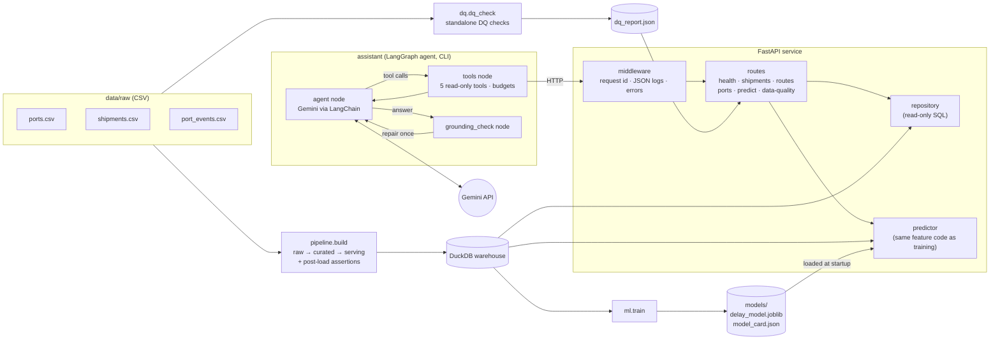

# Supply Chain Intelligence Mini-Platform

[](https://github.com/atharvapvt000/Maersk_assignment/actions/workflows/ci.yml)

A small end-to-end slice of a supply-chain intelligence platform built on the three supplied
CSVs:

- a **standalone data-quality check** that runs on the raw files
- a **layered DuckDB warehouse** (raw → curated → serving)
- a **FastAPI service** for shipments, routes, data quality and delay-risk prediction
- a **delay-prediction model** trained only on booking-time features
- a **LangGraph agent** (CLI) on Gemini 3.1 that answers questions through tool calls to the API

Stack: Python 3.12, FastAPI, DuckDB, scikit-learn, LangGraph + LangChain, Gemini 3.1, pytest, Docker
Compose, GitHub Actions.

## Contents

1. [Getting started](#getting-started)
2. [Architecture diagram](#architecture-diagram)
3. [API](#api)
4. [Tech choices](#tech-choices)
5. [Data pipeline and data model](#data-pipeline-and-data-model)
6. [Data quality summary](#data-quality-summary)
7. [ML: delay prediction](#ml-delay-prediction)
8. [GenAI assistant](#genai-assistant)
9. [Testing](#testing)
10. [CI/CD](#cicd)
11. [Production support runbook](#production-support-runbook)
12. [If I had more time](#if-i-had-more-time)
13. [Scaling to production](#scaling-to-production)
14. [Assumptions](#assumptions)
15. [Use of AI assistants](#use-of-ai-assistants)

---

## Getwting started

Requirements: Docker with Compose. Nothing else is needed to run the stack.

One command to clone and run everything:

```bash
git clone <repo-url> supply-chain && cd supply-chain && docker compose up --build
```

Then check it (interactive API docs at http://localhost:8000/docs):

```bash
curl localhost:8000/health
```

`make run` does the same in the background and waits until the API is healthy.

`docker compose up` runs two services:

1. **`pipeline`**: a one-shot job. It runs the data-quality checks on `data/raw/*.csv` (and
   stops if any check breaches its fail threshold), then builds the DuckDB warehouse into a
   shared volume and exits.
2. **`api`**: starts only after `pipeline` succeeds, and serves on port 8000. It loads the
   committed model artefact from `models/` at startup, so nothing is retrained.

A cold build takes 1–2 minutes on a laptop.

**Assistant (optional, needs a Gemini API key):**

```bash
cp .env.example .env               # add GEMINI_API_KEY to .env (git-ignored)
docker compose --profile assistant run --rm assistant \
  "Which routes have had the highest average delay this quarter?"
```

**Local development** (uses [uv](https://docs.astral.sh/uv/)):

```bash
make install          # install locked dependencies (Python 3.12)
make dq               # standalone DQ check  -> data/reports/dq_report.json
make data             # DQ gate + pipeline   -> data/warehouse/supply_chain.duckdb
make train            # retrain + evaluate   -> models/ (artefact + model card)
make api              # API on :8000
make test-unit        # fast unit tests, no infrastructure needed
make test-slow        # DQ report vs warehouse reconciliation on the real CSVs
make run && make test-int && make down     # integration tests against Docker
make ask Q="What is the on-time rate for shipments from Shanghai to Rotterdam?"
make eval-assistant   # live 10-question assistant evaluation (about 1 cent)
```

Example requests:

```bash
curl localhost:8000/shipments/SHP-00421
curl 'localhost:8000/shipments?origin=CNSHA&destination=NLRTM&status=DELAYED&departure_from=2025-01-01&limit=20'
curl localhost:8000/routes/CNSHA/NLRTM/stats
curl 'localhost:8000/routes/rankings?quarter=2025-Q3&metric=avg_delay_hours&limit=5'
curl -X POST localhost:8000/predict-delay -H 'content-type: application/json' \
  -d '{"shipment_id":"SHP-00421"}'
curl localhost:8000/data-quality/report
```

---

## Architecture diagram



The three services share one Docker image. The API mounts the warehouse read-only. The
assistant only talks to the API over HTTP, so it gets exactly the same validation and data as
any other client.

| Path | What it does |
|---|---|
| `app/` | FastAPI service: routers, repository (all SQL), predictor, error handling, logging middleware |
| `dq/` | Data-quality rules (`rules.py`) and the standalone checker (`dq_check.py`) |
| `pipeline/` | Warehouse build (`build.py`) and post-load assertions (`assertions.py`) |
| `ml/` | Feature engineering shared by training and serving (`features.py`), training and evaluation (`train.py`) |
| `assistant/` | LangGraph agent (`agent.py`), tools (`tools.py`), guardrails, CLI, live evaluation |
| `models/` | Trained model artefact and model card |
| `docs/data_model.md` | ER diagram, table contracts and column definitions |
| `tests/` | Unit and integration tests |

---

## API

| Endpoint | Returns | Errors |
|---|---|---|
| `GET /health` | `status`, `version`, `git_sha`, and checks for the data store (row count, `data_as_of`), model (version) and DQ report | 503 `degraded` if the data store or model is unavailable |
| `GET /shipments/{id}` | Full curated record, including derived fields and `dq_flags` | 422 malformed id, 404 `SHIPMENT_NOT_FOUND` |
| `GET /shipments` | `{items, total, limit, offset}`. Filters: `origin`, `destination`, `status`, `departure_from`, `departure_to`. `limit` ≤ 200 | 422 invalid parameters, 400 `INVALID_DATE_RANGE` |
| `GET /routes/{origin}/{destination}/stats` | Shipment count, arrived count, cancelled count, average delay in hours, on-time rate; optional date window | 404 `PORT_NOT_FOUND`, 400 `INVALID_ROUTE` |
| `GET /routes/rankings` | Routes ranked by average delay, on-time rate, late count or volume, optionally within one quarter (`2025-Q3`) | 404 `QUARTER_NOT_FOUND`, 422 |
| `GET /ports` | The 25 reference ports | – |
| `POST /predict-delay` | `delay_probability`, `predicted_late`, `risk_band`, `threshold`, `model_version`. Body: `{shipment_id}`, or booking-time fields (route, `booking_date`, planned dates, optional cargo, containers, weight, vessel) | 422 invalid body or unknown field (e.g. `actual_arrival`), 404 unknown shipment, 503 model not loaded |
| `GET /data-quality/report` | The JSON report written by the DQ step | 503 if not generated yet |

**Errors.** Every error, including FastAPI's own validation errors and unknown paths, uses one
format:

```json
{"error": {"code": "SHIPMENT_NOT_FOUND", "message": "...", "request_id": "...", "details": {}}}
```

Unexpected exceptions return a generic 500. The stack trace only goes to the logs.

**Logging.** Every request produces one JSON log line with method, path, route template, status,
latency in ms and `request_id`. A caller-supplied `X-Request-ID` is reused and echoed back.

**Design decisions**

- **A route with no shipments returns 200 with zero counts.** An unknown port returns 404. "No
  data" is a valid answer; an unknown entity is an error.
- **Delay metrics only use shipments that have arrived.** In-transit and cancelled shipments are
  counted but don't affect averages.

---

## Tech choices

| Area | Choice | Why |
|---|---|---|
| API | FastAPI + Pydantic | Typed request and response contracts, validation and OpenAPI docs out of the box |
| Data store | DuckDB (one embedded file) | The data is small (5k shipments, 25k events) and analytical. DuckDB gives fast SQL aggregations in-process with no server to run, and the whole warehouse rebuilds in about 1 s |
| Transformations | Plain SQL in DuckDB, orchestrated in Python | Readable and set-based at this size; no extra toolchain for 3 sources |
| DQ checks | Python standard library and a rule registry | Runs on the raw files with no dependencies and no store, as the brief requires. One registry drives the report and the pipeline |
| ML | scikit-learn (logistic regression, gradient boosting) | Right-sized for 4.5k tabular rows. One `Pipeline` object holds preprocessing and model, so serving can't drift from training |
| LLM | Gemini 3.1 through LangChain's `langchain-google-genai`. Default `gemini-3.1-flash-lite`; `GEMINI_MODEL=gemini-3.1-pro-preview` for Pro | Flash-Lite is the Gemini 3.1 model the key I developed with can call (the free tier has no Pro quota). It passes the evaluation at about $0.001 per question |
| Agent framework | LangGraph (on LangChain) | The agent is an explicit state graph, so the control flow, including where each guardrail runs, can be read and tested node by node. LangChain callbacks capture the exact messages sent on every LLM call for the logs |
| Tests | pytest, FastAPI `TestClient`, httpx | Standard. The app factory accepts injected components, so unit tests need no infrastructure |
| Packaging | uv with a lockfile | Fast, reproducible installs; the same lockfile locally, in CI and in Docker |
| Lint and format | ruff | One fast tool for both |
| CI | GitHub Actions | Free for private repos, runs Docker natively |

**At 100× the data** (about 500k shipments and 2.5M events), DuckDB would still handle the
queries on one machine. What stops working is the operating model: one file, full rebuilds and a
single writer. I'd move the serving layer to PostgreSQL (indexed lookups, many concurrent readers,
incremental upserts), keep curated history as partitioned Parquet in object storage, and load
events incrementally. More in [Scaling to production](#scaling-to-production).

**What I decided not to do**

- **No ORM.** The few queries are hand-written, parameterised SQL in one module.
- **No dbt, Great Expectations or Airflow.** They are the right tools at larger scale, but here
  they would add setup for a reviewer without adding guarantees. The rule registry,
  reconciliation test and post-load assertions cover the same ground.
- **No vector store or RAG.** The assistant's questions are structured queries ("on-time rate
  for this route"), so tool calls returning computed answers are more precise than retrieving
  similar text. RAG would make sense for unstructured data such as incident reports.
- **No authentication, caching or Kubernetes.** Out of scope, and listed in the runbook as
  production next steps.
- **No per-prediction explanations.** The model has no measurable signal (see the ML section), so
  explaining its outputs would be misleading.

---

## Data pipeline and data model

```
data/raw/*.csv
  ├─► dq.dq_check ─► dq_report.json ─► GET /data-quality/report      (standalone, runs first)
  └─► pipeline.build
        raw.*      untyped copy of each CSV + lineage (row number, file, SHA-256)
        curated.*  typed, cleaned, deduplicated; rejected rows kept with reasons; derived fields
        serving.*  shipments, ports, port_events, route_performance, port_daily_activity
        post-load assertions ─► atomic swap into place
```

- **One set of rules.** Each data-quality rule is defined once in `dq/rules.py`, with its
  severity, action, detection logic and reasoning. The DQ step reports on the rules, and the
  pipeline applies them, using the rule name as the reason for a rejected row or as a row flag.
  A test checks, row by row on the real data, that the rows the report says were dropped,
  quarantined or flagged are exactly the rows the warehouse treated that way.
- **Derived fields** in `curated.shipments`:
  - `actual_delay_hours` = actual minus planned arrival, NULL until the shipment arrives
  - `on_time_flag` = delay ≤ 24 hours
  - `route_key` = `origin → destination`
  - `transit_days_planned`, `transit_days_actual`
  - additionally `departure_delay_hours` and `booking_lead_days`
- **Idempotent.** Each run rebuilds the warehouse into a temporary file, runs 16 post-load
  assertions, and only then replaces the live file. The assertions check unique keys, valid
  port references, every raw row ending up either curated or rejected, and derived fields that
  agree with each other. Running twice gives identical tables (tested). If anything fails, the
  previous warehouse stays in place.

| Table | Grain / key | Notes |
|---|---|---|
| `serving.shipments` | `shipment_id` (unique) | 4,906 shipments with derived fields and `dq_flags`. What the API reads |
| `serving.ports` | `port_code` | 25 ports |
| `serving.port_events` | `event_key` (unique) | All 25,000 events; duplicate IDs get a `#n` suffix |
| `serving.route_performance` | route × departure quarter | Counts, average, median and p90 delay, on-time rate |
| `serving.port_daily_activity` | port × day | Event counts, DELAYED events, delay minutes |
| `curated.rejected_rows` | dataset × source row | Dropped and quarantined rows, with the reasons and the original record |
| `serving.build_info` | one row per build | Build time, data snapshot date, source file hashes, row counts |

`shipments.origin_port`, `shipments.destination_port` and `port_events.port_code` all reference
`ports.port_code`. The full ER diagram and column definitions are in
[docs/data_model.md](docs/data_model.md).

---

## Data quality summary

```bash
python -m dq.dq_check --input data/raw --output data/reports/dq_report.json [--fail-on fail]
```

The check uses only the Python standard library and reads the CSVs directly. It runs 32 rules;
21 of them found issues. Each entry in the JSON report has the rows affected, percentage,
severity, pass/warn/fail status, action, how the issue was detected, and the reasoning.

| Dataset | Issue | Rows | Severity | Handling |
|---|---|---|---|---|
| shipments | Placeholder or unknown port codes (`XXTST`, `ZZZZZ`, `UNKNW`) | 95 (1.9%) | critical | Quarantine |
| shipments | Exact duplicate rows | 8 | warning | Drop |
| shipments | Same `shipment_id` with different values | 20 | warning | Keep the last occurrence, quarantine older versions |
| shipments | Status spelled inconsistently (`Complete`, `COMPLETED`, `delivered`) | 92 | info | Normalise to `DELIVERED`, unless arrival is missing (row below) |
| shipments | Status missing or `N/A` | 54 | warning | Set to `UNKNOWN`, flag |
| shipments | Status says delivered but there is no actual arrival | 92 | warning | Set to `UNKNOWN`, flag |
| shipments | No actual timestamps (not cancelled) | 146 | warning | Keep; exclude from delay metrics and ML labels |
| shipments | Actual departure before the booking date | 39 | warning | Null `actual_departure` only; arrival delay still counts |
| shipments | Cargo type case or whitespace variants | 261 | info | Normalise |
| shipments | Cargo type missing | 15 | warning | NULL, flag |
| shipments | Weight not numeric | 73 | warning | NULL, flag |
| shipments | Weight ≤ 0 | 36 | warning | NULL, flag |
| shipments | Container count ≤ 0 | 23 | warning | NULL, flag |
| shipments | Container count outlier (510–996, against a 99th percentile of 40) | 17 | warning | NULL, flag |
| shipments | Actual timestamps after the data snapshot date | 283 | info | Flag only |
| port_events | Same `event_id` used for different events | 206 rows (103 IDs) | warning | Keep all; add a unique `event_key` |
| port_events | Missing `event_type` | 140 | warning | NULL, flag |
| port_events | `DELAYED` event with 0 delay minutes | 12 | info | Flag |
| port_events | Vessel not found in shipments | 207 | info | Flag |
| port_events | Missing notes | 1,913 | info | None (optional field) |
| ports | Missing country (BEANR) | 1 | warning | Flag |

The other 11 rules found nothing, for example invalid IDs, unparseable timestamps, impossible
planned dates and unknown event ports.

**Result:**
- shipments: 5,028 rows → 4,906 curated (7 dropped, 115 quarantined)
- events: 25,000 → 25,000
- ports: 25 → 25

**Reasoning behind the main decisions**

- **The 146 rows without actual timestamps are one corrupted batch.** All of them have either an
  odd status spelling or a missing status. A "delivered" shipment with no arrival time can't be
  trusted, so its status becomes `UNKNOWN`. The booking data is fine, so the rows are kept, but
  they are excluded from delay metrics and from training labels.
- **The repeated event IDs are not duplicates.** Every pair differs in timestamp, port, vessel
  and type, so deduplicating would delete 103 real events.
- **I fix the field, not the row, whenever the rest of the row is still trustworthy.** A
  departure before booking only nulls `actual_departure`, and a container-count outlier only
  nulls `container_count`.
- **Rows that would lose information are quarantined, not deleted.** Only exact duplicates are
  dropped.
- **Severity and status mean different things.** Severity is how bad one affected row is. Status
  (pass/warn/fail) compares the share of affected rows with a threshold per rule. `--fail-on fail`
  blocks the pipeline only when a whole feed looks broken. Today no rule fails and 17 are at warn.

---

## ML: delay prediction

**Task:** at booking time, predict whether a shipment will arrive more than 24 hours late.
Training data is the 4,564 shipments with a known arrival, of which 40.4% were late.

**Features.** Defined in `ml/features.py`; training and the `/predict-delay` endpoint use the
same code, so they can't compute features differently. Everything is computed as of the
booking date:

| Group | Features |
|---|---|
| Booking details | origin, destination, cargo type, vessel, departure month, container count, weight, booking lead days, planned transit days |
| Port reference | congestion score at origin and destination |
| History | late rate for the same route and for the same vessel, using only shipments that **arrived before the booking**, smoothed towards the overall rate |
| Port activity | events, delayed events and delay minutes at origin and destination over the 7 and 30 days **before** the booking |

**Excluded as leakage:** `actual_departure`, `actual_arrival`, the delay itself, on-time flag,
actual transit time, departure delay, DQ flags, and **`status`**. `status = DELAYED` matches
"more than 24h late" on all 1,901 rows, so it is the label in disguise. A unit test fails if any
of these fields becomes a feature.

**Evaluation**

- **Time-based split on booking date:** train before April 2025 (2,741 rows), validate on
  2025-Q2 (828), test from July 2025 (995).
- **Model settings and the decision threshold are chosen on validation only.** Each model is
  then retrained on train + validation and scored once on test.
- **Uncertainty:** a 95% bootstrap confidence interval on test AUC, and a permutation test
  (labels shuffled 1,000 times) to check whether the AUC could come from chance.
- **Leakage canary:** the same pipeline, given one post-departure field. If the evaluation
  couldn't catch leakage, the canary wouldn't score high.

**Results on the test set** (995 shipments, 41.0% late):

| Model | Test ROC AUC [95% CI] | Permutation p | PR AUC | Brier | Precision | Recall | F1 |
|---|---|---|---|---|---|---|---|
| Always predict the base rate | – | – | 0.410 | 0.242 | 0.410 | 1.000 | 0.582 |
| Route-history rule | 0.476 [0.439, 0.511] | 0.90 | 0.407 | 0.249 | 0.409 | 0.956 | 0.573 |
| **Logistic regression (shipped)** | **0.506 [0.471, 0.543]** | 0.36 | 0.424 | 0.242 | 0.405 | 0.961 | 0.569 |
| Gradient boosting | 0.520 [0.482, 0.558] | 0.14 | 0.444 | 0.245 | 0.410 | 0.998 | 0.581 |
| Leakage canary (+ `departure_delay_hours`) | 0.968 | – | – | – | – | – | – |

Precision, recall and F1 use the threshold chosen on validation (0.377 for the shipped model).

**What this means**

- **No model does better than chance.** Every confidence interval includes 0.5, and no
  permutation test is significant. During validation the logistic regression chose its strongest
  regularisation, which makes it close to predicting the base rate.
- **The evaluation itself works.** The canary scores 0.97 under the same setup. The signal
  appears after departure but isn't in the booking-time data. Exploring the data showed the same:
  late rates stay between about 35% and 45% across cargo types, ports, lead times, transit times,
  months and congestion levels.
- **The threshold explains the precision/recall pattern.** The F1-optimal threshold flags 97% of
  shipments as late, which nearly reproduces "always predict late". At a threshold of 0.5 it
  flags none. I've reported this as it is rather than picking a threshold that makes the numbers
  look better.
- **The probabilities are well calibrated around the base rate**, so they are honest even though
  the model can't rank shipments.
- **I shipped the model exactly as it was evaluated.** The API reports its version, and the
  assistant tells users it has little predictive power. Full details, calibration and feature
  importances are in [models/model_card.json](models/model_card.json).

**Monitoring in production**

| What to watch | How | Trigger |
|---|---|---|
| Input drift | PSI per feature against the training window; share of unseen routes and vessels; DQ flag rates | PSI > 0.2 on a key feature, or more than 10% unseen routes |
| Output drift | Distribution of predicted probabilities and risk bands | Mean prediction more than 5 points away from the recent observed late rate |
| Real performance | When arrivals come in (labels lag 3–35 days): rolling 4-week AUC, Brier score, calibration error | AUC more than 0.05 below the model card, or calibration error above 0.05 |
| Base rate | Weekly late rate overall and by route | A shift of more than 5 points: retrain and re-pick the threshold |
| Schedule | Monthly retraining | Promote only if the new model beats the current one under the same time-based evaluation, after running in shadow mode |

---

## GenAI assistant

A command-line assistant built as a **LangGraph** agent on **Gemini 3.1** (via LangChain's
`langchain-google-genai`). It answers questions such as:

- "Which routes have had the highest average delay this quarter?"
- "What is the on-time rate for shipments from Shanghai to Rotterdam?"
- "What is the delay risk for shipment SHP-00421?"

**How it works.** The agent is a LangGraph state graph with three nodes:

```
START → agent ──tool calls──► tools ──► agent
              └──answer──► grounding_check ──fails, first time──► agent (repair)
                                           └──passes, or fails twice──► END
```

| Node | What it does |
|---|---|
| `agent` | Calls Gemini with the system prompt and conversation. Tools are bound only while the tool budget lasts |
| `tools` | Runs the tool calls the model asked for, enforcing the budgets, and returns results as tool messages labelled `T1`, `T2`, … |
| `grounding_check` | Checks every number in the answer against this question's tool results. On failure it routes back to `agent` once with a correction message |

Follow-up questions in interactive mode reuse the conversation history.

**Model and cost.** The default is `gemini-3.1-flash-lite`. The key I developed with is on Google's
free tier, which has no quota for 3.1 Pro; with billing enabled, `GEMINI_MODEL=gemini-3.1-pro-preview`
switches to Pro. Costs measured on the 10-question evaluation:

| Model | Cost per question | Basis |
|---|---|---|
| `gemini-3.1-flash-lite` | **about $0.0012** (total $0.0115 for 10 questions) | Measured. About 3.1k input and 250 output tokens per question, 1.9 model calls on average. Median latency about 4 s; free-tier throttling occasionally adds 30–45 s to a single call. Pricing $0.25 / $1.50 per million input / output tokens |
| `gemini-3.1-pro-preview` | about $0.009 | Estimated from the same token counts at $2 / $12 per million |

Prices can be overridden with `GEMINI_PRICE_IN` and `GEMINI_PRICE_OUT`.

**Tools.** The model decides when to call them. Each tool is a read-only call to the API.

| Tool | API endpoint |
|---|---|
| `query_shipments(filters)` | `GET /shipments` |
| `get_shipment(shipment_id)` | `GET /shipments/{id}` |
| `get_route_stats(origin, destination)` | `GET /routes/{origin}/{destination}/stats` |
| `rank_routes(quarter, metric, ...)` | `GET /routes/rankings` |
| `predict_delay(shipment_id)` | `POST /predict-delay` |

Port names are mapped to codes using the port list from `GET /ports`. "This quarter" means the
quarter of the latest data (2025-10-14, so 2025-Q4). Since that quarter is only partly covered,
the assistant says so and also gives the last full quarter.

**Guardrails.** All are enforced in code, not only requested in the prompt.

1. **Every figure must come from a tool and be cited.** Each number in the answer must match a
   value returned by a tool for that question, allowing for rounding and for 0.404 vs 40.4%. The
   answer must also cite where the number came from, e.g. `[T1]`. If the check fails, the model
   gets one chance to correct itself. If it still fails, the answer is shown with a visible
   warning listing the unverified figures.
2. **Tool-call limits:** at most 6 tool calls per question and 30 per session, plus a limit on
   model calls per question. Once the budget is spent, extra calls get a `TOOL_BUDGET_EXHAUSTED`
   result and the next model call is made without tools.
3. **Domain only.** Off-topic questions get a fixed refusal and no tool calls. Text returned by
   tools is treated as data, never as instructions.

**Logging.** Each session writes a JSON Lines file to `logs/assistant/`. LLM calls are captured
by a LangChain callback handler (`on_chat_model_start` / `on_llm_end`), so every call is logged
with:
- the exact prompt sent (system instruction and full conversation)
- the tools offered, and the tool calls with their arguments and responses
- the model's output
- token usage, cost and latency

Guardrail interventions and the final answer are logged too.

**Evaluation.** `make eval-assistant` asks 10 questions: the three above, plus counts, a date
range, shipment details, a ranking, an unknown shipment, an off-topic question and a
prompt-injection attempt. Each answer is checked for the right tool, the right facts (compared
with values fetched from the API at run time), grounding, and no tool use on the adversarial
questions. Latest result: **10/10**.

---

## Testing

| Suite | Command | Covers | Needs |
|---|---|---|---|
| Unit (165 tests) | `make test-unit` | API routes and error handling (with a fake repository), logging middleware, every DQ rule, pipeline rules and idempotency, post-load assertions, ML feature timing and leakage guards, the committed model artefact, the LangGraph agent and its guardrails (the compiled graph run with a scripted fake chat model instead of Gemini) | Nothing. Most tests take milliseconds; the few that build a 9-row fixture warehouse in embedded DuckDB take under a second. About 9 s in total |
| Real-data checks (2 tests) | `make test-slow` | Reconciles the DQ report against the warehouse row by row on the real CSVs | Nothing; about 4 s |
| Integration (16 tests) | `make run && make test-int` | Real HTTP requests to the Docker stack: shipment lookup, unknown ID returns 404, filters and pagination, route stats and rankings, DQ report, predict-delay with the trained model | Docker |
| Assistant evaluation (10 questions) | `make eval-assistant` | Live Gemini calls, checked against the API | API key; costs about 1 cent, so not run in CI |

CI runs the unit and real-data tests together, then the integration tests against the
Docker stack. The integration tests wait for `/health` before starting, so container startup time doesn't make
them flaky. `BASE_URL` points them at any deployed instance.

---

## CI/CD

The pipeline is implemented in `.github/workflows/ci.yml`. It runs on every pull request and
every push to `main`:

| Job | Steps |
|---|---|
| `lint` | `ruff check`, `ruff format --check` |
| `unit-tests` | Install locked dependencies, run the DQ gate on the raw CSVs, run the unit and real-data tests with coverage, upload the results |
| `build-and-integration` (after both pass) | Build the Docker image tagged with the commit SHA, start the stack, run the integration tests, print container logs on failure, tear down |

All three jobs must pass before merging. The same sequence runs locally with `make ci`.

**Deployment plan** (not implemented, because there is no target environment):

1. A merge to `main` pushes the image, tagged with the commit SHA, to a registry.
2. Deploy to staging and run the integration suite against it (`BASE_URL=...`).
3. Promote the same image to production with a rolling or blue-green release, gated on `/health`
   returning the expected `git_sha`.
4. **Rollback:** redeploy the previous tag.

---

## Production support runbook

**Checking the service after a deployment**

```bash
curl -s $HOST/health          # expect status "ok", the deployed git_sha, ~4,906 shipments
                              # and the expected model version
BASE_URL=$HOST uv run pytest -m integration -q
```

Then watch the access logs for a few minutes: the 5xx rate should be about zero and lookups
should stay well under 50 ms.

**Most likely failures**

| Symptom | Likely cause | How to diagnose | Fix |
|---|---|---|---|
| `/health` returns 503, `data_store.ok` is false | Warehouse missing or corrupt: the pipeline job failed or the volume isn't mounted | `docker compose logs pipeline` (look for `pipeline_failed` or `pipeline_assertions_failed`) | Fix the input, rerun the pipeline, restart the API. Rebuilds are idempotent |
| API never starts | The DQ gate stopped the pipeline (a feed breached a fail threshold) | Run `make dq` and look for checks with `"status": "fail"` | Fix the upstream file, or change the threshold if it was a false alarm |
| `/predict-delay` returns 503 | Model artefact missing or incompatible | `/health` → `checks.model.error` | Redeploy the previous image (the model ships inside it) |
| 5xx errors or slow responses | A bad release or a heavy query | Filter access logs by status or latency and group by `route`; follow a `request_id` to its stack trace | Roll back if it began with a release |
| Assistant reports `Gemini API error 429` | Quota or rate limit at Google | The error message and the per-call latencies in the session log | Wait, enable billing, or choose another model with `GEMINI_MODEL` |

**Rolling back a bad release:** redeploy the previous image tag
(`GIT_SHA=<previous> docker compose up -d api`). Code, model and raw data are all inside the
image, so one rollback restores a consistent version. The warehouse is rebuilt from scratch, so
there are no migrations to undo. Confirm with `/health` that `git_sha` matches.

**Before real production I would add:**
- Prometheus metrics and OpenTelemetry tracing
- alerts on 5xx rate, p95 latency, failing health checks and a stale `data_as_of`
- central log storage
- API keys in a secrets manager (not environment files)
- authentication and rate limiting at the gateway
- image vulnerability scanning in CI
- the model monitoring described in the ML section

---

## If I had more time

**The biggest gap is signal, not modelling.** Before tuning anything I'd look for data that
plausibly predicts delays:
- vessel positions (AIS) and carrier schedule reliability
- weather and port strike feeds
- berth waiting queues
- the free-text event notes ("Port strike affecting berth 4" is a strong hint)

Once a model beats chance, I'd add per-prediction explanations and choose the threshold from
business costs (a missed delay versus a false alarm) instead of maximising F1.

**Engineering:**
- contract tests generated from the OpenAPI schema
- a load test to set latency targets
- keyset pagination for `/shipments`
- incremental loading for the event feed
- a small review screen for quarantined rows

**Assistant:**
- a larger evaluation set (about 50 questions) with automated answer-quality grading, run nightly
  within a budget
- a cost and quality comparison of Flash-Lite and 3.1 Pro once billing is enabled
- streaming responses
- caching the static parts of the prompt

---

## Scaling to production

**What breaks first: the single DuckDB file and full rebuilds.** Neither copes with millions of
shipments arriving continuously. I'd split storage by how it's used:
- **Curated history:** partitioned Parquet or Iceberg tables in object storage, built
  incrementally (dbt) on a scheduler (Dagster or Airflow) with freshness targets.
- **Serving:** PostgreSQL for the API, with keyset pagination and precomputed route aggregates.
- **Events:** the port event feed would come from a real stream such as Kafka. Consumers would
  deduplicate on a key that is stable at the source (a hash of the record, rather than today's
  occurrence number), handle late events with a watermark, and update the daily port aggregates
  incrementally.

**Data quality moves into the stream.** The same rule definitions would run on every batch:
- row-level problems are quarantined as they arrive
- feed-level thresholds become alerts
- publishing to the serving layer stops automatically when a feed breaches its fail threshold
- the reconciliation test becomes a continuous check that rows in equal rows curated plus rows
  rejected, per batch

**The API scales horizontally.** It is already stateless, so it can run as several replicas
behind a load balancer, with:
- a Postgres connection pool
- a short-lived cache for popular aggregates
- authentication and rate limits
- tracing

For 24/7 reliability I'd define service-level objectives (for example 99.9% availability and p95
under 200 ms) with alerts on error-budget burn, deploy across availability zones with blue-green
releases, test database restores regularly, and keep this runbook up to date for on-call.

**ML needs point-in-time features at scale.** `ml/features.py` already applies the
point-in-time rule in SQL; at scale this becomes a feature store, so training and live scoring
read identical values. Beyond that:
- models are registered (MLflow) and run in shadow mode before promotion
- scoring happens when a booking is created, not only on request
- the monitoring plan above runs as scheduled jobs

**The assistant needs per-user limits** (budgets and rate limits), async request handling,
caching for repeated questions, a fallback model when the provider returns errors, removal of
personal data before prompts are logged, and the evaluation running on a schedule as a gate for
prompt or model changes.

---

## Assumptions

- Timestamps have no timezone, so all are treated as UTC.
- On time means arriving no more than 24 hours after the planned arrival (24h exactly counts as
  on time).
- For duplicate shipment IDs, the last row in the file wins. There's no `updated_at` column, so
  file order is the only signal of which version is newer.
- `COMPLETE` and `COMPLETED` mean `DELIVERED`, unless there's no actual arrival time.
- The data snapshot date is the latest booking or event timestamp: 2025-10-14 23:55. "This
  quarter" for the assistant is the quarter containing that date. Shipments with actual
  timestamps after it are flagged, not dropped.
- The vessel is known at booking time, so it's allowed as a model feature.
- The container-count limit (100 per shipment) is a fixed sanity bound, not fitted to the data.

---

## Use of AI assistants

I used an AI coding assistant (Claude Code) throughout this project.

**Where it helped:**
- writing boilerplate (FastAPI scaffolding, Dockerfile, CI workflow)
- first drafts of SQL, tests and documentation
- running exploratory queries on the data

**Decisions I made:**
- the overall architecture and the scope of each part
- keeping the status-corrupted shipments as `UNKNOWN` instead of quarantining them
- keeping all events with repeated IDs instead of deduplicating them
- the time-based evaluation, and reporting a model with no signal honestly instead of chasing a
  better-looking number
- choosing Gemini 3.1 as the LLM and LangGraph as the agent framework, with the guardrails as
  explicit graph nodes

**How I checked the output:**
- data claims are backed by queries or tests
- the DQ report is reconciled against the warehouse row by row
- the ML evaluation is checked with a leakage canary
- the assistant is evaluated against values fetched live from the API
