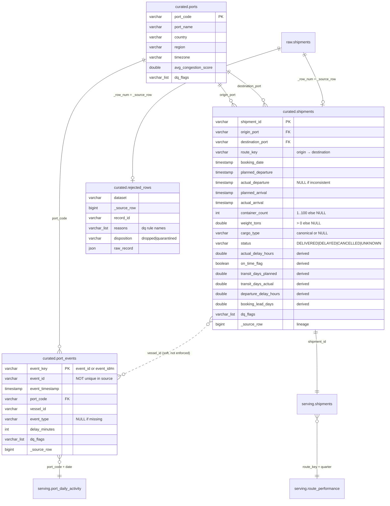

# Data model

One DuckDB file (`data/warehouse/supply_chain.duckdb`), four schemas. `pipeline/build.py` builds
it from scratch on every run and swaps it in atomically, but only after the post-load
assertions in `pipeline/assertions.py` pass.

## Layers

| Layer | Tables | Contract |
|---|---|---|
| `raw` | `raw.ports`, `raw.shipments`, `raw.port_events` | A byte-faithful copy of each CSV with every column as `VARCHAR`. Lineage columns: `_row_num` (1-based, file order, the same numbering the DQ report uses), `_source_file`, `_source_sha256`. Never modified. |
| `ref` | `ref.status_alias`, `ref.cargo_type`, `ref.dq_rules` | Lookup tables generated from code (`app/domain.py`, `dq/rules.py`). They put the rules inside the warehouse for auditing. |
| `curated` | `ports`, `shipments`, `port_events`, `rejected_rows` | Typed, cleaned and deduplicated, with every DQ rule applied. **Every raw row ends up either in a curated table or in `rejected_rows`, exactly once** (asserted). Row-level `dq_flags` name the rule that touched the row. |
| `serving` | `shipments`, `ports`, `port_events`, `route_performance`, `port_daily_activity`, `build_info` | What consumers read: the API, the GenAI assistant tools and ML training. There are no lineage columns, and the column set is stable. |

## Tables

| Table | Grain / key | Notes |
|---|---|---|
| `curated.shipments` / `serving.shipments` | One row per `shipment_id` (unique index in serving) | 4,906 rows from 5,028 raw. The last occurrence of a duplicated ID wins. |
| `curated.port_events` / `serving.port_events` | One row per `event_key` | All 25,000 events are kept. 103 IDs collide across 206 genuinely different events; the first occurrence keeps the ID and later ones become `EVT-x#2`. |
| `curated.ports` / `serving.ports` | `port_code` | 25 ports. BEANR is flagged `missing_country`. |
| `curated.rejected_rows` | (`dataset`, `_source_row`) | 122 shipment rows: 7 dropped (exact duplicates), 115 quarantined (94 unknown port, 20 superseded versions, 1 both). Holds the full raw record and all reasons. |
| `serving.route_performance` | (`route_key`, `quarter_start`) | Per route and **planned-departure** quarter: shipment, arrived, cancelled and late counts; average, median and p90 delay; on-time rate. Pre-aggregated for "worst routes this quarter" questions. |
| `serving.port_daily_activity` | (`port_code`, `activity_date`) | Daily event counts (arrivals, departures, DELAYED events), events with a delay, total and average delay minutes. A congestion signal; ML must only use dates **before** booking. |
| `serving.build_info` | One row per build | `built_at`, `data_as_of` (the inferred snapshot, 2025-10-14 23:55), the SHA-256 of each source file, row counts. |

## Derived fields (curated.shipments)

| Field | Definition | NULL when |
|---|---|---|
| `actual_delay_hours` | `actual_arrival − planned_arrival` in hours (negative = early) | No actual arrival |
| `on_time_flag` | `actual_delay_hours ≤ 24` | No actual arrival |
| `route_key` | `origin_port ‖ ' → ' ‖ destination_port` | Never |
| `transit_days_planned` | `planned_arrival − planned_departure` in days | Never (plan dates are required) |
| `transit_days_actual` | `actual_arrival − actual_departure` in days | Either actual is missing or `actual_departure` was nulled as inconsistent |
| `departure_delay_hours` | `actual_departure − planned_departure` in hours | No usable actual departure |
| `booking_lead_days` | `planned_departure − booking_date` in days | Never |

## Status semantics

`status` is **descriptive, never used as a metric input or an ML feature**. In the raw data,
`DELAYED` matches `actual_delay_hours > 24` on all 1,901 rows, so it is the label in disguise. All
metrics come from timestamps. `UNKNOWN` covers both missing status values and statuses that
contradict missing actuals (for example "Complete" with no arrival time).

## Idempotency and failure behaviour

- **Full rebuild into `<db>.tmp`, then post-load assertions, then `os.replace()`.** Re-running
  produces identical tables (tested), and readers never see a half-built file.
- **Any failure** (missing input, SQL error, failed assertion) deletes the temporary file and
  leaves the previous warehouse live. The process exits 1, which also blocks the API from
  starting in Compose.
- **At this scale (about 1 s per build) a full rebuild is the simplest correct option.** If
  `port_events` really arrived as a stream, I'd switch to an incremental load: a watermark on
  `event_timestamp` with a lateness allowance, upserts on `event_key`, and the daily mart
  recomputed only for affected `(port, date)` partitions. The surrogate key would then need a
  source-stable component (for example a hash of the full record) instead of an occurrence number,
  because occurrence order isn't stable across incremental loads.
